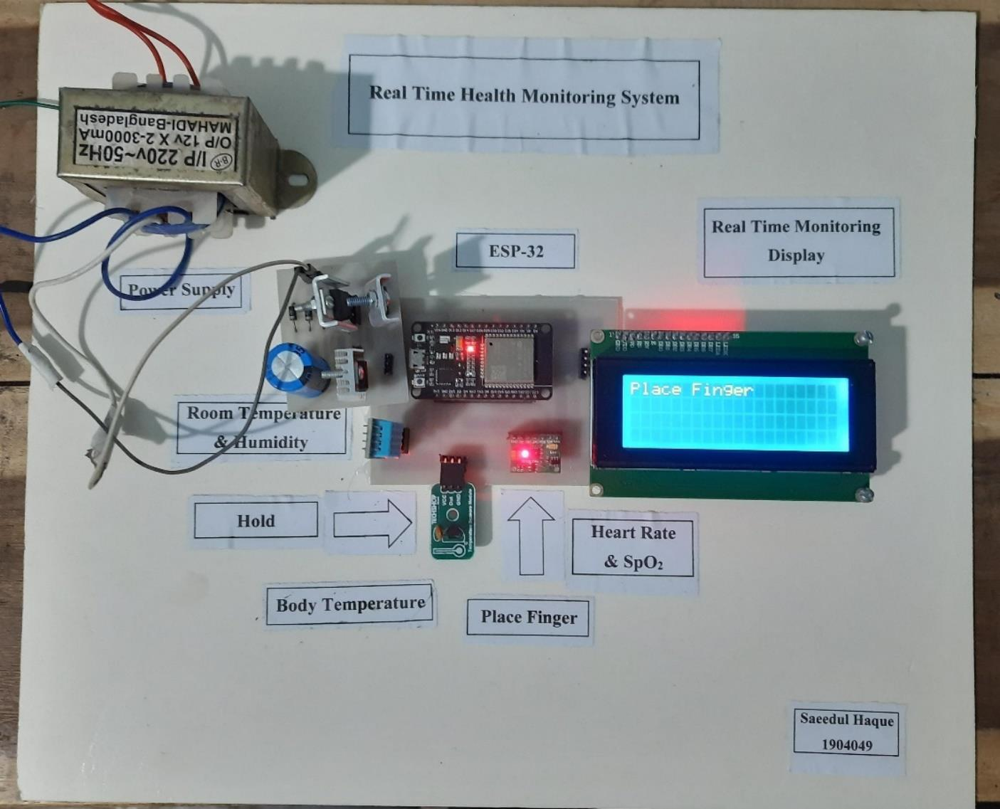
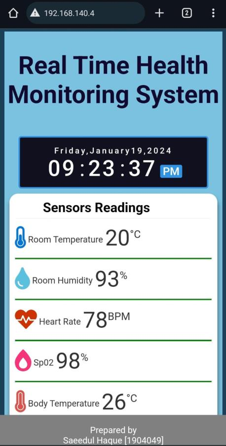
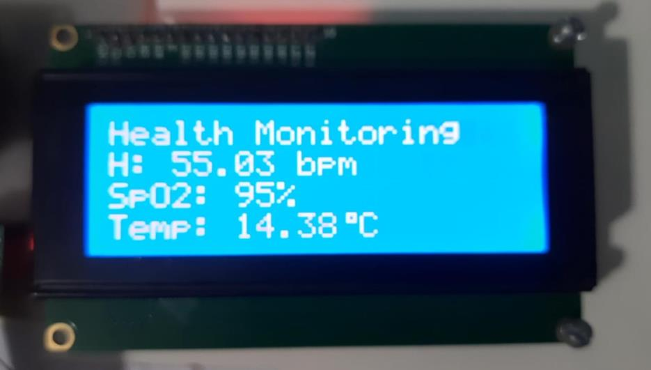
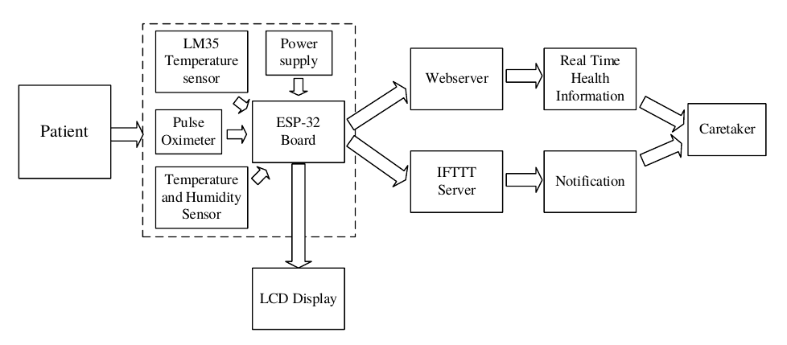
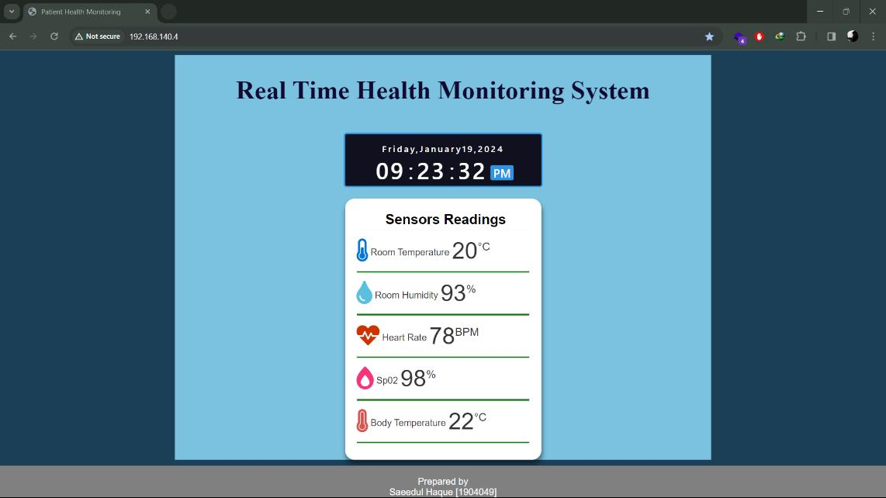
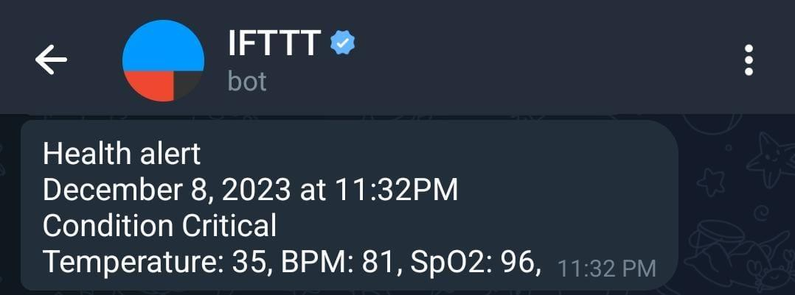
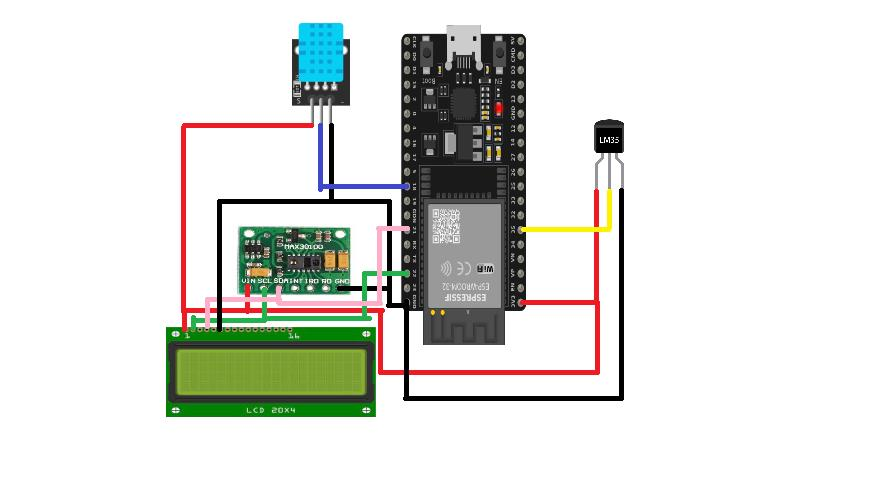
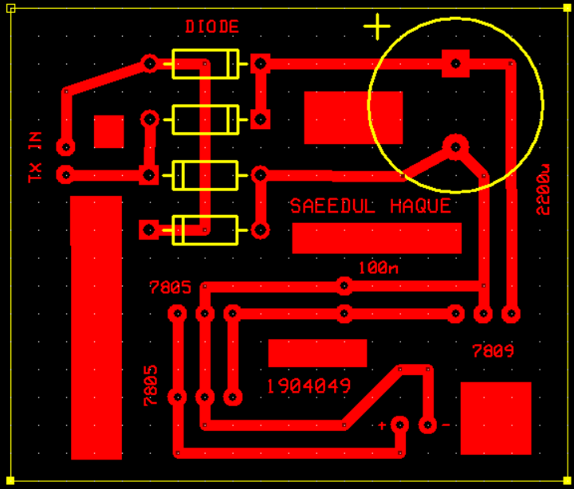
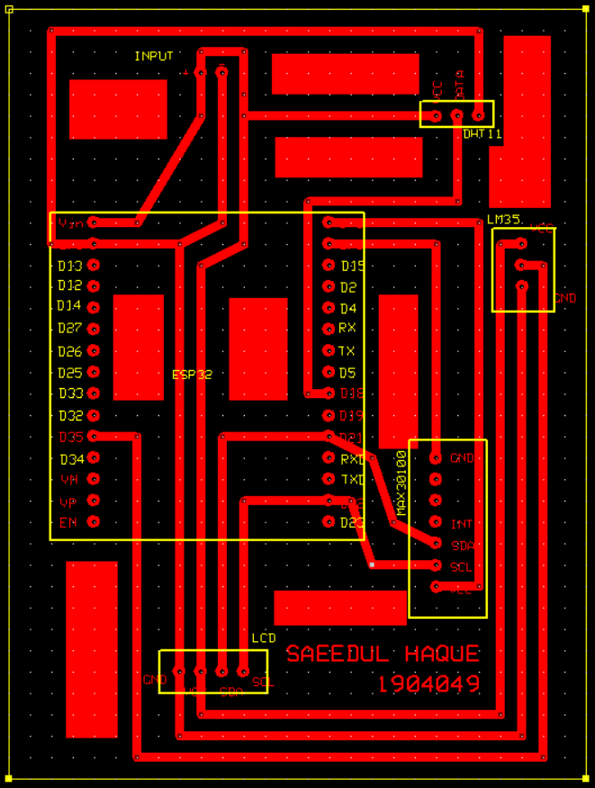

# 🩺 IoT-Based Real-Time Patient Health Monitoring System

<p align="center">
  
  
  
  
  
</p>

<p align="center">
  <b>An ESP32-based bedside monitor that tracks heart rate, SpO₂, body temperature and room conditions, shows them on an LCD and a live web dashboard, and sends an alert to a caretaker's phone.</b>
</p>

<p align="center">
  
  
  
</p>

---

## 📌 Overview

Continuous patient monitoring normally needs someone at the bedside. This project lets a caretaker watch a patient's vitals remotely. An **ESP32** reads a pulse oximeter and two temperature sensors, shows the values locally on a 20×4 LCD, serves them as a live web page on the local network, and calls an **IFTTT** webhook to notify the caretaker when the alert condition is met.

## ✨ Features

- **Five live readings:** heart rate, SpO₂, body temperature, room temperature and room humidity.
- **Local LCD display:** a 20×4 I²C LCD shows heart rate, SpO₂ and body temperature, and prompts "Place Finger" until a finger is detected.
- **Live web dashboard:** the ESP32 hosts the page itself on port 80. It updates every second with no page reload, includes a live clock, and has a responsive layout for phones and PCs.
- **Instant alerts:** the ESP32 sends an HTTP request to an IFTTT webhook with the temperature, heart rate and SpO₂ values, which IFTTT turns into a phone notification.
- **Mains or battery power:** a step-down transformer, rectifier and regulator board lets it run from AC mains, or from a DC source.
- **Custom PCBs:** a power-supply board and an ESP32 main board, designed in ExpressPCB.
- **Credentials kept out of the code:** Wi-Fi and IFTTT details live in a git-ignored `secrets.h`.

## 🧠 System architecture

<p align="center">
  
</p>

1. **Sensing:** the MAX30100 measures heart rate and SpO₂ optically (I²C), the LM35 measures body temperature (analog), and the DHT11 measures room temperature and humidity.
2. **Processing:** the ESP32 reads all sensors in its main loop and refreshes the outputs once per second.
3. **Local output:** the readings are written to the LCD, and the ESP32 serves them as a web page on its local IP address.
4. **Remote alert:** when the alert condition is met, the ESP32 calls the IFTTT webhook, and IFTTT notifies the caretaker.

## 🔬 Results

The prototype reads all five parameters and delivers them through three channels: the LCD, a web dashboard on a PC or phone, and a push notification.

<p align="center">
  
  
</p>
<p align="center"><i>Live dashboard in a desktop browser (left) and on a phone (right).</i></p>

<p align="center">
  
  
</p>
<p align="center"><i>LCD read-out (left) and the alert notification received through IFTTT (right).</i></p>

| Item | Result |
|---|---|
| Parameters monitored | 5 (heart rate, SpO₂, body temperature, room temperature, room humidity) |
| Output channels | 3 (20×4 LCD, local web dashboard, IFTTT notification) |
| LCD and dashboard refresh | every 1 s |
| Pulse oximeter LED current | 11 mA (`MAX30100_LED_CURR_11MA`) |
| Alert payload | temperature, heart rate and SpO₂ (for example, 35 °C, 81 BPM, 96 %) |
| PCBs designed | 2 (power supply, ESP32 main board) |

No quantitative accuracy testing against a reference instrument was done for this prototype, so no accuracy figures are claimed.

### Known limitations

- **Body-temperature calibration:** the conversion in the sketch assumes a 10-bit, 5 V ADC and treats the LM35 value as Fahrenheit, while the ESP32 ADC is 12-bit and 3.3 V. Recalibrate against a reference thermometer before trusting the body-temperature number. The readings in the screenshots above come from this uncalibrated version.
- **Alert logic:** the alert condition checks only temperatures (room above 32 °C and body above 35 °C), not heart rate or SpO₂. It also sends a request on every pass of the loop while the condition holds, with no rate limit.
- **Power:** a power-supply failure shuts the system down, and the mains-powered version needs an AC supply.
- **Sampling:** the optical sensor runs at 100 Hz, so a new sample can take up to 10 ms.
- **Network:** the dashboard is reachable only from the local network, and the IFTTT call uses plain HTTP.

## 🔌 Hardware

| Component | Qty | Role |
|---|:-:|---|
| ESP32 DevKit v1 | 1 | Controller, Wi-Fi, web server |
| MAX30100 pulse oximeter and heart-rate sensor | 1 | Heart rate and SpO₂ (I²C) |
| LM35 temperature sensor | 1 | Body temperature (analog, 10 mV/°C) |
| DHT11 temperature and humidity sensor | 1 | Room temperature and humidity |
| 20×4 LCD with I²C module (address 0x27) | 1 | Local display |
| Center-tapped step-down transformer (220 V AC to 12 V) | 1 | Mains power |
| 1N4007 diodes | 4 | Rectifier |
| Filter capacitors (including 2200 µF) | 2 | Smoothing |
| Voltage regulator ICs (7805) | 3 | 5 V supply |
| PVC board, connecting wires | 1 | Assembly |

### Pin map

| Function | ESP32 pin |
|---|---|
| LM35 output | GPIO35 (ADC) |
| DHT11 data | GPIO18 |
| MAX30100 and LCD (I²C) | default I²C pins (SDA GPIO21, SCL GPIO22) |

## 🧩 Circuit and PCB design

<p align="center">
  
</p>

<p align="center">
  
  
</p>
<p align="center"><i>Power-supply board (left) and ESP32 main board (right), designed in ExpressPCB.</i></p>

## 🚀 Getting started

1. **Install the libraries** in the Arduino IDE: `LiquidCrystal_I2C`, `DHT sensor library`, and `MAX30100lib` (for `MAX30100_PulseOximeter.h`).
2. **Add your credentials.** In `src/health_monitor/`, copy `secrets.example.h` to `secrets.h` and fill in your Wi-Fi name, Wi-Fi password and IFTTT Webhooks key. `secrets.h` is git-ignored.
3. **Set up IFTTT.** Create an applet with the **Webhooks** trigger and the event name `Health alert`. The request carries `value1` (temperature), `value2` (heart rate) and `value3` (SpO₂), which you can use in the notification text.
4. **Upload** `health_monitor.ino` to the ESP32 (board: *ESP32 Dev Module*).
5. **Open the Serial Monitor** at 9600 baud. When the board connects, it prints its IP address.
6. **Open that IP address** in a browser on the same network to see the live dashboard.

## 🔭 Future work

- AI-based anomaly detection for critical health alerts.
- Encryption and other security features for the data link.
- A mobile app for remote monitoring.

## 📁 Repository structure

```text
.
├── README.md
├── LICENSE
├── .gitignore                        # keeps secrets.h out of git
├── src/
│   └── health_monitor/
│       ├── health_monitor.ino        # ESP32 firmware
│       └── secrets.example.h         # template for Wi-Fi and IFTTT credentials
├── assets/
│   ├── diagrams/                     # block diagram, circuit, PCB layouts
│   └── images/                       # prototype, dashboard, LCD and alert photos
└── docs/
    └── project_report.pdf
```

## 👤 Author

**Saeedul Haque** · [haquesaeedul@gmail.com](mailto:haquesaeedul@gmail.com)

## 📄 License

This project is licensed under the [MIT License](LICENSE).
